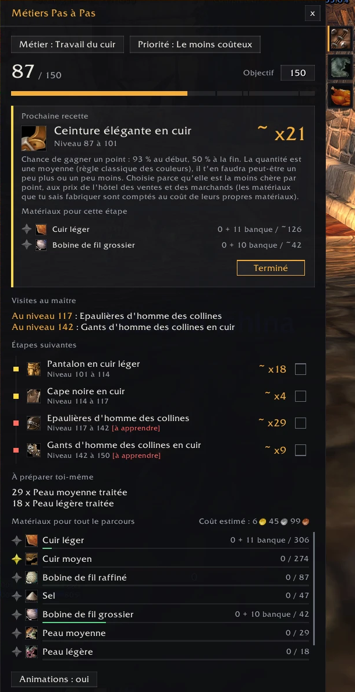

# Profession Path


**Step-by-step profession leveling for World of Warcraft Forever** (client 1.60.1, interface `16001`): what to craft next, how many, with which materials, at what cost — and why. Information only: it never crafts, buys or moves anything for you.

- **Install**: copy the `ProfessionPath` folder into `World of Warcraft\_forever_\Interface\AddOns\`, or install it from CurseForge.
- **Use**: open your profession window once, talk to your profession trainer once (with the "Unavailable" filter ticked), then type `/ppath`.
- **Bugs and suggestions**: open an issue on this repository, with a screenshot and the output of `/ppath debug`.
- **Status**: public beta, tested in game on Leatherworking and Blacksmithing.
- **Licence**: MIT (see `LICENSE`). Author: Ryugan.



The rest of this document is the full French manual.

---

## Notice en français

Add-on pour **WoW Forever** qui te guide pour monter tes métiers : quelle recette fabriquer maintenant, combien, avec quels matériaux, et pourquoi.

L'add-on **informe seulement**. Il ne fabrique rien, n'achète rien et ne déplace pas ton personnage.

- Version de l'add-on : 1.0.0-beta1 (auteur : Ryugan, licence MIT)
- Version du jeu visée : WoW Forever 1.60.1 (build 70862), numéro d'interface `16001`

## Installation

1. Copie le dossier `ProfessionPath` (celui qui contient `ProfessionPath.toc`) dans :
   `C:\Program Files (x86)\World of Warcraft\_forever_\Interface\AddOns\`
2. Lance le jeu. Sur l'écran des personnages, bouton **AddOns** : vérifie que « Profession Path » est coché.

## Utilisation

1. En jeu, ouvre **une fois** ta fenêtre de métier (touche `K` par défaut, puis ton métier). L'add-on lit alors tes vraies recettes et écrit une ligne dans le chat pour le confirmer.
2. Tape `/mpp` (ou `/ppath`, `/profpath`, `/metiers`) pour ouvrir la fenêtre. Tu peux aussi passer par le menu des add-ons près de la mini-carte.

Dans la fenêtre :

| Élément | À quoi ça sert |
|---|---|
| Pastille **Métier** | Passe d'un métier lu à l'autre. |
| **Onglets à droite** | Une icône par métier de ton personnage : clique pour l'afficher directement. Un onglet grisé est un métier que tu n'as pas encore ouvert. |
| Pastille **Priorité** | Change la façon de choisir les recettes (voir plus bas). |
| **Objectif** | Le niveau que tu vises. Tape un nombre puis Entrée. |
| **Prochaine recette** | La recette à faire maintenant, la quantité, l'explication et ses matériaux pour toute l'étape (possédé / nécessaire). |
| **Terminé** / cases à cocher | Sort une recette du parcours, qui est recalculé. |
| **Étapes suivantes** | La suite du parcours, dans l'ordre. Passe la souris sur une étape pour voir ses matériaux. |
| **Matériaux** | Le total nécessaire, et ce que tu possèdes déjà. Ce qui est resté en banque est affiché à part (« 0 + 16 banque / 244 »). En vert quand tu en as assez. |
| **Étoile** devant un matériau | Le met en favori (un second clic l'enlève). Les favoris portent une étoile dans tes sacs et dans la fenêtre des marchands qui les vendent, pour tous tes personnages. |
| **Réinitialiser** | Remet les recettes marquées comme terminées. |
| **Animations : oui / non** | Coupe les animations de la fenêtre si elles te gênent. |

Un **bouton sur la mini-carte** ouvre aussi la fenêtre ; glisse-le pour le déplacer, `/mpp minimap` le cache ou le réaffiche.

La section **PNJ du métier** montre ton maître et les marchands de fournitures (ceux de ta zone d'abord) ; le bouton **Carte** pose le repère du jeu sur eux. L'add-on retient leur position quand tu leur parles.

`/mpp partager` ouvre un texte à copier avec les maîtres, marchands et recettes de maître que tu as trouvés : colle-le dans une issue GitHub (modèle « Share trainers and vendors ») pour qu'ils soient ajoutés à l'add-on pour tout le monde. Les contributions sont vérifiées par `node tools/import_shares.js <fichiers>`.

Autres commandes : `/mpp lire` (relit le métier ouvert), `/mpp recettes` (liste les numéros de tes recettes), `/mpp debug` (état technique), `/mpp aide`.

## Comment les recommandations sont calculées

1. **Lecture du jeu.** Les recettes, leurs matériaux, celles que tu connais et leur couleur actuelle viennent directement du jeu. Rien n'est inventé.
2. **Chance de gagner un point.** Avec les seuils de couleur d'une recette (voir « Données des recettes »), l'add-on applique la règle classique des couleurs : 100 % tant que la recette est orange, puis une baisse régulière du seuil jaune jusqu'au seuil gris (0 %).
3. **Parcours.** Niveau par niveau, il choisit la meilleure recette selon ta priorité, et regroupe les niveaux consécutifs en étapes. La quantité est exacte quand chaque fabrication donne un point à coup sûr ; sinon c'est une moyenne, affichée avec « environ ».
4. **Recettes du maître.** Quand tes recettes connues tombent sous 75 % de chance et que ton maître en enseigne une meilleure à ton niveau, le parcours prévoit une visite. Tout ce qui est utile et apprenable à ce niveau est regroupé dans la même visite, pour limiter les trajets. Il faut avoir parlé une fois au maître pour que l'add-on connaisse ses recettes (voir « Les maîtres de métier »).
5. **Recettes apprises par un objet** (plan, patron, formule). Elles ne sont proposées qu'en dernier recours, quand plus rien d'autre n'est efficace, car rien ne garantit que tu puisses trouver l'objet.
6. **Garde-fou.** Tant qu'une recette utilisable donne au moins 50 % de chance, celles qui sont presque grises sont écartées, quelle que soit la priorité.
7. **La couleur vue en jeu l'emporte.** Une recette grise en jeu n'est jamais proposée, même si les données disent autre chose.

### Les maîtres de métier

Les fichiers du jeu ne disent pas à quel niveau un maître enseigne une recette. Cette information n'existe que dans la fenêtre du maître. L'add-on la lit quand tu lui parles, et la garde pour tous tes personnages.

- **Une seule visite par maître suffit.** Une ligne dans le chat confirme la lecture.
- Dans la fenêtre du maître, garde le filtre **« Indisponible »** coché, sinon l'add-on ne voit pas les recettes des niveaux à venir. Il te le rappelle si besoin.
- Tant qu'un maître n'a pas été lu, ses recettes restent hors du parcours et la fenêtre te le signale.
- L'add-on n'achète rien : il lit seulement la liste.

### Les priorités

- **Le plus simple** : la meilleure chance de point avec les recettes connues ; à égalité, le moins de matériaux.
- **Le moins de matériaux différents** : reste le plus longtemps possible sur les matériaux déjà utilisés.
- **Le moins coûteux** : n'apparaît que si l'add-on **Auctionator** est installé, car c'est lui qui fournit les prix de l'hôtel des ventes. L'add-on y ajoute les **prix des marchands** : il les note quand tu ouvres un marchand (objets vendus contre de l'argent, en stock illimité), et retient le plus bas des deux. Un matériau **que tu sais fabriquer toi-même** est compté au coût de ses propres matériaux (table du jeu SpellEffect, fichier `Data/Crafts.lua`). Sans aucun prix connu pour un matériau, la recette est classée en dernier, pas devinée. Le **coût estimé du parcours** est affiché à droite du titre des matériaux ; il signale les objets sans prix. Quand fabriquer un matériau toi-même revient moins cher que l'acheter, il passe dans la section **À préparer toi-même** et la liste des matériaux affiche à sa place ce qu'il faut réunir pour le fabriquer.

« Le plus rapide » n'existe pas : rien ne permet de l'estimer honnêtement.

## Données des recettes

Le jeu donne la couleur d'une recette à ton niveau actuel, mais pas les niveaux où elle changera de couleur. Ces **seuils** sont dans `ProfessionPath/Data/Thresholds.lua`.

- **D'où ils viennent** : des tables de données du jeu lui-même, pour la version exacte 1.60.1.70862, publiées par wago.tools. Rien n'est inventé ni repris d'une autre version de WoW.
- **Ce qu'il y a dedans** : 2 390 recettes avec leurs seuils jaune et gris (le vert est le milieu des deux).
- **Niveau d'apprentissage** : connu pour 1 653 recettes, presque toutes grâce à l'objet qui les apprend (plan, patron, formule). Pour les 737 autres, surtout des recettes de maître, il est noté `0` (inconnu) et l'add-on le lit en jeu chez le maître.
- **Écartées** : 154 lignes où jaune et gris sont identiques (pas de vraie plage de progression). Pour ces recettes, l'add-on se rabat sur la couleur vue en jeu.

### Corriger ou ajouter une recette

Ne modifie pas `Thresholds.lua` (il est refabriqué par un outil). Ouvre `ProfessionPath/Data/Corrections.lua` avec le Bloc-notes et ajoute une ligne :

```lua
[numéro de la recette] = { orange, jaune, vert, gris },
```

- Le numéro s'obtient en jeu avec `/mpp recettes`.
- Les quatre nombres : niveau requis pour l'apprendre (0 si inconnu), puis passage au jaune, au vert et au gris.
- N'écris que des valeurs relevées dans WoW Forever.

Après une modification, tape `/reload` en jeu.

### Après une mise à jour du jeu

Les seuils peuvent changer avec une nouvelle version. Pour les refabriquer : télécharger dans un même dossier les tables `SkillLineAbility`, `ItemEffect`, `ItemXItemEffect`, `ItemSparse`, `SpellReagents`, `SpellName` et `SkillLine` sur `https://wago.tools/db2/<Table>/csv?build=<nouvelle version>`, puis lancer `node tools/gen_thresholds.js <dossier> <nouvelle version>`. Ensuite `node tools/bench.js 150 300` fait tourner le calcul sur tous les métiers pour repérer une anomalie. Penser aussi à mettre à jour le numéro d'interface dans `ProfessionPath.toc` s'il a changé.

## Limites connues

- **Recettes de maître** : elles n'entrent dans le parcours qu'après avoir parlé une fois au maître. Les maîtres de rang supérieur enseignent d'autres recettes : il faut leur parler aussi.
- Le rapprochement entre le maître et tes recettes se fait par le nom. Une recette dont le nom diffère entre les deux fenêtres ne sera pas reconnue.
- La règle de chance est la règle classique des couleurs ; elle n'a pas été confirmée officiellement pour WoW Forever. Les quantités « environ » sont des moyennes, et les derniers points avant le gris coûtent cher.
- Pour une recette apprise par un objet, l'add-on donne le nom de l'objet, mais pas où le trouver.
- Les matériaux que tu sais fabriquer ne sont détaillés que si leur coût de fabrication est connu et inférieur au prix d'achat. Sans Auctionator, les prix manquent le plus souvent et ils restent affichés tels quels.
- Les bonus de compétence (objets, race) ne sont pas pris en compte.
- Chaque métier doit être ouvert une fois par personnage pour être lu (`/mpp lire` force une relecture).
- **Étoile dans les sacs** : vue en jeu avec Bagnon 12.1.8. Chez les marchands : fenêtre du jeu seulement, onglet « Rachat » non marqué. Les sacs du jeu, AdiBags, Baganator, LiteBag, Baggins, Inventorian, ElvUI et ArkInventory sont branchés d'après leur fonctionnement connu, sans essai sur chacun. `/mpp debug` indique lesquels sont branchés. BetterBags n'est pas pris en charge. La banque du jeu n'affiche pas l'étoile (celle des add-ons de sacs, si).

## Organisation du projet

```
wow-metiers/
├─ ProfessionPath/          le dossier à installer et à publier
│  ├─ ProfessionPath.toc    carte d'identité de l'add-on (version du jeu, liste des fichiers)
│  ├─ Locales.lua           textes français et anglais
│  ├─ Data/Thresholds.lua   seuils de couleur des recettes (fabriqué par un outil)
│  ├─ Data/Corrections.lua  tes corrections à la main
│  ├─ Planner.lua           calcul du parcours
│  ├─ Favorites.lua         composants favoris (étoile)
│  ├─ Bags.lua              étoile des favoris dans les sacs (jeu et add-ons de sacs)
│  ├─ Core.lua              lecture du jeu, sauvegarde, commandes
│  ├─ Vendor.lua            lecture des prix chez les marchands
│  ├─ Data/VendorPrices.lua prix de marchand livrés avec l'add-on
│  ├─ Data/Crafts.lua       objet fabriqué par chaque recette (fabriqué par un outil)
│  ├─ Theme.lua             apparence : couleurs, boutons, animations (design system)
│  └─ UI.lua                la fenêtre
├─ tests/                   vérifications automatiques du calcul (hors jeu)
├─ tools/gen_thresholds.js  outil qui fabrique Thresholds.lua depuis la table du jeu
├─ CURSEFORGE.md            description prête pour la page CurseForge
└─ README.md
```

## Tests

Deux vérifications tournent hors du jeu : le calcul du parcours, et un essai « à blanc » qui charge tout l'add-on dans un faux jeu, ouvre la fenêtre et clique sur chaque bouton. Cet essai attrape les erreurs de programmation, mais ne dit pas si le rendu est joli. Il faut Node.js :

```bash
npm install
```

```bash
npm test
```

Seul le dossier `ProfessionPath` est à publier ; `tests`, `tools`, `node_modules` et `package.json` restent sur ton ordinateur.
